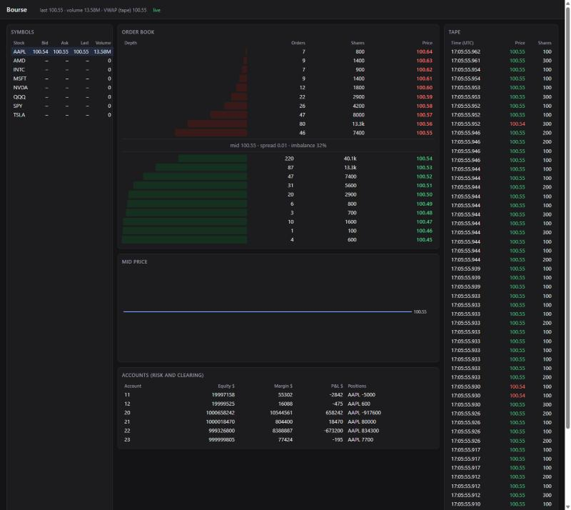
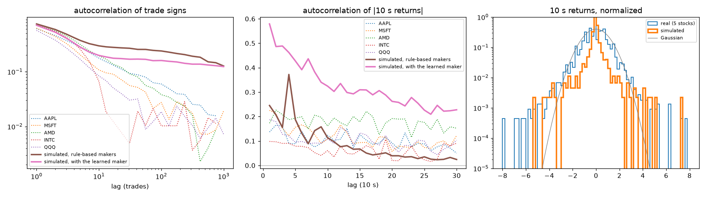

# Bourse

An electronic stock exchange built from scratch in six languages. It has:
- a lock-free matching engine;
- gateways that speak the NASDAQ protocols (OUCH and ITCH) and FIX;
- distribution of market data to many subscribers;
- risk management and clearing;
- an agent-based market simulation with market makers trained by
  reinforcement learning;
- a live order book in the browser.

It is checked against real data: one full day of NASDAQ TotalView-ITCH
(368 million messages) is rebuilt order by order, and the engine picks the
same orders to execute as NASDAQ did.

| part | language | what it is |
|---|---|---|
| [`engine/`](engine) | C++20 | the matching engine (price-time priority, limit, market, IOC, FOK, post-only, self-trade prevention, cancel, replace, mass cancel, account blocking), the shared-memory bus, the ITCH book rebuilder, benchmarks |
| [`gateway/`](gateway) | Rust | OUCH 5.0 over SoupBinTCP and FIX 4.4 order entry with pre-trade risk checks; the ITCH 5.0 feed; a load generator |
| [`marketdata/`](marketdata) | Go | takes the ITCH feed, rebuilds the books, fans out to many subscribers over MoldUDP64 (UDP, with retransmission), WebSocket and a JSON API |
| [`risk/`](risk) | Kotlin | risk and clearing: positions, P&L, scenario margin, automatic blocking of accounts, central-counterparty netting and settlement |
| [`sim/`](sim) | Python | agent-based market on the exchange's own engine, calibrated to the real data; market makers trained with PPO (PyTorch); stylized facts |
| [`ui/`](ui) | TypeScript | the live order book: depth ladder, tape, mid-price chart, accounts |



## Results

All measured on one laptop: Intel i7-10870H (8 cores, 16 threads), 16 GB of
RAM, Windows 11, and the same machine's WSL2 Ubuntu 24.04 for the Linux
numbers. Every table, every percentile and every parameter is in
[`results/README.md`](results/README.md).

### The real order book, rebuilt exactly

The data is NASDAQ TotalView-ITCH 5.0 for 30 January 2019: 368,366,634
messages, 11.2 GB, 8,713 stocks. The C++ engine's book and the Go
market-data books each replay the whole day.

| | C++ | Go |
|---|---:|---:|
| orders added | 164,696,353 | 164,696,353 |
| messages naming an unknown order | 0 | 0 |
| executions or cancels exceeding the open quantity | 0 | 0 |
| crossed or locked books in regular hours (186.7 million checks) | 0 | 0 |
| orders left at the end of the day | 0 | 0 |
| shares executed (displayed / hidden) | 1,119,323,998 / 173,244,448 | the same |
| replay speed | 5.1 million messages/s (72 s) | 2.2 million messages/s |

**Exact matching.** ITCH does not show the incoming orders, only the
resting orders they executed against. A run of executions with the same
nanosecond timestamp, against one side of one stock, comes from one incoming
order. For each such run during regular trading, the engine was asked which
resting orders an order of that size and limit price would hit. That makes
**5,195,904 runs and 7,982,960 fills**. In every single run, the engine's
answer is the same orders, with the same quantities, in the same order.

That holds only after one correction. NASDAQ ranks orders within a price
level by their **order reference number**, which reflects when the order was
entered, not when the feed first showed it. Orders entered before the open
for regular hours only appear on the feed at 9:30, but they keep the
priority of their entry. Ranked by arrival on the feed instead, 1,992 runs
come out different.

### Latency and throughput

| layer | Windows 11 | Linux (WSL2) |
|---|---|---|
| the engine alone, per command | 12.1 M commands/s; p50 94 ns, p99 357 ns, p99.9 496 ns | 10.3 M/s; p50 105 ns, p99 380 ns, p99.9 516 ns |
| through the shared-memory bus (three threads), 1 M commands/s offered | p50 0.37 µs, p99 18 µs | p50 0.32 µs, p99 31 µs |
| the bus at saturation | 6.5 M commands/s | 5.1 M commands/s |
| order entry over TCP, OUCH, 10,000 orders/s: round trip | p50 91 µs, p99 203 µs, p99.9 269 µs | p50 45 µs, p99 123 µs, p99.9 160 µs |
| of which inside the gateway (socket read to acknowledgment written) | p50 80 µs, p99 164 µs | p50 22 µs, p99 75 µs |
| plain TCP echo on loopback, for scale | p50 46 µs, p99 115 µs | p50 57 µs, p99 141 µs |
| FIX 4.4, 10,000 orders/s: round trip | p50 121 µs, p99 257 µs | p50 61 µs, p99 132 µs |
| OUCH at 100,000 orders/s | p50 182 µs, p99.9 970 µs | p50 71 µs, p99.9 282 µs |

The latency of a command through the bus is counted from when it was
scheduled to be sent, not from when it was sent. So a producer that falls
behind still counts (no coordinated omission).

The tails beyond p99 on the bus vary from run to run, between 0.05 and 4 ms
for p99.9. They come from the operating system interrupting the spinning
threads of a laptop that is also running other software, not from the
engine: in process, p99.99 stays at 1.3 µs.

The cost over TCP is mostly the network stack. On Windows, writing 40 bytes
to a loopback socket takes about 17 µs at the median; the same gateway code
spends 22 µs inside itself on Linux and 80 µs on Windows. (The TCP echo
baseline is slower than an OUCH round trip on Linux because it blocks on
`read`, while the load generator spins.)

**Market data.** The orders were sent at 20,000/s, about 16,000 ITCH
messages/s, fanned out by the Go server over UDP:

| subscribers | Windows: p50 / p99 | Linux: p50 / p99 |
|---:|---|---|
| 1 | 109 µs / 0.34 ms | 152 µs / 0.23 ms |
| 10 | 0.38 ms / 0.80 ms | 0.29 ms / 3.9 ms |
| 50 | 1.6 ms / 4.4 ms (808,000 messages/s delivered) | 0.41 ms / 3.7 ms |
| 100 | overloaded: 1.7 s, gaps (recovered) | 1.1 ms / 6.5 ms (1.6 million messages/s) |

With each subscriber dropping 1% of its packets on purpose, every lost
message was recovered through MoldUDP64 retransmission: 31,606 on Windows
and 31,670 on Linux, with 0 missing. Unicast fan-out sends each packet once
per subscriber, so it stops scaling between 50 and 100 subscribers on
Windows. Real feeds use multicast for this reason.

### The whole exchange, end to end

`eval/replay_check.py` simulates a market with the engine in process
(600 s of trading: 121,773 commands, 7,892 trades). It then sends exactly the same commands to the running
exchange over OUCH, one TCP session per group of agents: C++ engine, Rust
gateway, Go market data, Kotlin risk and clearing, each in its own process.
The result:
- the trades the clients see are identical to the simulation's: price,
  quantity and order;
- the book the Go server rebuilt from the ITCH feed is identical to the
  simulation's final book;
- every account's position in clearing equals its inventory in the
  simulation;
- the net settlement balances: shares and cash each sum to zero.

The same check runs in CI on Linux.

### A simulated market, compared with the real one

Eight stylized facts, computed with the same code on the real stocks
(regular hours, auctions excluded) and on simulated 6.5-hour days of the
calibrated market:
- heavy tails;
- no autocorrelation of returns;
- volatility clustering;
- long memory of trade signs;
- a spread of one or two ticks;
- positive and concave impact;
- bursty trading;
- fat-tailed distances of limit orders.

The parameters were calibrated by random search, against the median of five
real stocks. That cut the distance to the real statistics from 97.7 (the
hand-set parameters) to 6.1.

| statistic | AAPL | MSFT | AMD | INTC | QQQ | simulated (rule-based makers / with the learned one) |
|---|---:|---:|---:|---:|---:|---:|
| trades per minute | 216 | 161 | 250 | 72 | 132 | 839 / 828 |
| volatility over 10 s (ticks) | 5.28 | 2.35 | 1.93 | 1.26 | 3.04 | 6.45 / 3.08 |
| kurtosis of 10 s returns | 4.4 | 27.1 | 5.6 | 18.5 | 69.6 | 420.0 / 255.7 |
| Hill tail exponent of 10 s returns | 3.54 | 2.97 | 4.28 | 5.13 | 3.10 | 1.40 / 1.97 |
| autocorrelation of \|10 s returns\|, lags 1-30 | 0.101 | 0.115 | 0.179 | 0.062 | 0.102 | 0.158 / 0.241 |
| decay exponent of the trade-sign autocorrelation | 0.53 | 0.64 | 0.84 | 0.67 | 0.65 | 0.10 / 0.09 |
| mean spread (ticks) | 2.25 | 1.09 | 1.03 | 1.01 | 1.15 | 1.32 / 1.17 |
| coefficient of variation of inter-trade times | 2.90 | 3.32 | 4.50 | 3.23 | 2.89 | 2.45 / 2.41 |



The simulated days pass all eight checks, with the rule-based makers and
with the learned one. Some of the numbers are still clearly off:
- the tails of the returns are too heavy: kurtosis 256-420 against 4-70,
  and a tail exponent of 1.4-2.0 against 3-5;
- trade signs remember too long: their autocorrelation decays with
  exponent 0.1, against 0.5-0.8 for the real stocks;
- there are about four times as many trades per minute.

The distribution of normalized 10 s returns is 0.42-0.47 away from the
real stocks' (Kolmogorov-Smirnov distance). For scale, the real stocks are
0.13-0.28 from each other.

### Market makers trained with reinforcement learning

One maker's seat is driven by a policy trained with PPO for
400,000 decisions (one per simulated second), in the calibrated market
next to a fixed-spread maker and an Avellaneda-Stoikov one.
- **Actions:** each second it chooses a half-spread (0.5-3.5 ticks) and a
  skew (-2 to +2 ticks).
- **Observations:** its inventory, the spread, the recent return and
  volatility, the imbalance of trades and of the best queues, and the time
  left.
- **Reward:** the change in its wealth marked to the mid, minus a penalty
  on the square of its inventory.

The same seat was then given, on 20 half-hour days it never saw, to each
rule:

| maker | mean P&L ($) | std ($) | profitable days | mean \|inventory\| (shares) |
|---|---:|---:|---:|---:|
| learned (PPO) | -236 | 595 | 40% | 98 |
| Avellaneda-Stoikov | -439 | 811 | 30% | 211 |
| fixed, at the best bid and ask | -2,323 | 3,871 | 40% | 3,686 |

The learned maker loses the least and carries the smallest inventory. It
learned to stand back: three quarters of the time it quotes 3.5 ticks from
the mid, against the one or two of the rules. But it still loses money on
average, like every maker here. This market has informed traders, and a
maker that only sees prices and order flow pays them (adverse selection).
A first training run, without reward normalization and with a smaller
inventory penalty, ended worse than Avellaneda-Stoikov.

## How it works

```
  clients ──OUCH 5.0 / SoupBinTCP──┐                      ┌──► risk and clearing (Kotlin)
  clients ──FIX 4.4 ───────────────┤                      │      positions, margin, blocking,
                                   ▼                      │      settlement; writes the limits file
                          gateway (Rust)                  │
                pre-trade risk, order ids, sessions       │
                     │ commands             ▲ events      │
                     ▼                      │             │
   ┌──────────── shared-memory bus (one mapped file) ────────────┐
   │  inbound rings (one producer each) ──► matching engine (C++) │
   │                         one thread, price-time priority     │
   │  event log (one writer, many readers) ◄─────────────────────│
   └──────────────────────────────────────────────────────────────┘
                     │ events
                     ▼
          ITCH gateway (Rust) ──SoupBinTCP──► market data (Go) ──► MoldUDP64 subscribers
                                                     │           ──► WebSocket ──► order book (TS)
                                                     └── JSON API
```

**The bus** ([`docs/bus.md`](docs/bus.md)) is one memory-mapped file with a
fixed binary layout, read and written the same way from C++, Rust, Go
(through the gateway's feed) and Kotlin. There are no locks:
- **Inbound rings.** Each producer (a gateway process, the risk service)
  claims its own single-producer single-consumer ring of 64-byte commands.
- **Event log.** The engine writes every event to one ring in the order it
  happened: accepted, executed, cancelled, replaced, booked, blocked.
  Readers register, publish how far they have read, and the engine never
  overwrites an unread event. A reader that stops sending heartbeats is
  dropped, so it cannot stall the exchange.

Every event carries the ring position of the command that caused it, so any
reader can match responses to requests without a lookup table. The engine
can be replayed: the same commands give the same events.

**The engine.**
- Orders sit in a pool and are found through an open-addressing hash map
  with backward-shift deletion.
- Each side of a book is a vector of price levels sorted from the worst
  price to the best, so the best is at the back. Most activity happens
  there.
- Each level is a FIFO of orders linked by pool index.
- Cancelling down to a smaller size keeps priority; a replace loses it, as
  in OUCH.
- The tests compare every event of 400,000 random commands with a naive
  reference engine, and run the bus with two producers and two readers on
  rings small enough to wrap thousands of times.

**The gateways.** One thread busy-polls the sockets (mio) and the event log.
- **OUCH 5.0** follows the official specification: the Enter Order,
  Replace, Cancel, Accepted, Replaced, Canceled, Executed and Rejected
  messages, at their exact offsets. UserRefNums are strictly increasing.
  Quantities are the total liability of an order chain, including what
  already executed. Duplicate or superfluous requests are ignored silently,
  as the specification says.
- **SoupBinTCP** sessions keep their sequenced messages, so a client that
  logs in again gets everything it missed.
- **FIX 4.4** handles logon, heartbeats, test requests, sequence-number
  checks, resend requests (stored messages with PossDupFlag, gap fills for
  administrative ones), NewOrderSingle, OrderCancelRequest,
  OrderCancelReplaceRequest, ExecutionReports and OrderCancelReject.
- **Pre-trade risk** checks maximum quantity, order value, a price collar
  around the last trade, total open value per account, the message rate,
  and the accounts the risk service blocked.
- **The ITCH 5.0 feed** shows what NASDAQ's shows: orders once they rest,
  executions against them (with the match number), cancels, deletes, and
  replaces (as one `U` when the new order goes straight to the book).

**Market data.** The Go server logs in to the ITCH feed and rebuilds the
books. It publishes MoldUDP64 packets of up to 1,400 bytes to every
subscriber that sends `JOIN`. Gaps are repaired by retransmission requests
to the same socket, served from the full message store. Heartbeats carry
the next sequence number, so a subscriber also notices a gap at the end of
a burst. WebSocket clients get conflated book snapshots (at most 20 per
second) and every trade; WebSocket is implemented on the Go standard
library alone.

**Risk and clearing.** The Kotlin service reads the event log through the
same mapped file (VarHandles with acquire/release ordering).
- **Novation.** Every trade becomes two positions against the central
  counterparty.
- **Positions.** It tracks positions, average cost, realized and unrealized
  P&L.
- **Margin.** The margin is the worst loss of an account's positions over
  price scenarios (each stock alone and all together, ±3, 6 and 10%), plus
  10% of its open orders.
- **Blocking.** An account whose equity falls below its margin is blocked:
  the service sends a block command on its own inbound ring, and the engine
  cancels the account's orders and refuses new ones. The service also
  writes the limits file the gateways reload.
- **Settlement.** At the end of the day it nets the obligations per account
  and stock, and checks that shares and cash each sum to zero.

**The simulated market** runs on the exchange's engine through its C
interface, in continuous time (Gillespie's method). The agents:
- zero-intelligence liquidity providers: power-law distances from the best
  price, random cancels;
- zero-intelligence takers;
- institutions splitting Pareto-sized meta-orders: the source of the long
  memory of order signs;
- informed fundamentalists: they lean toward a value that follows a random
  walk with stochastic volatility;
- trend followers;
- market makers: a fixed spread, Avellaneda-Stoikov, and one learned with
  PPO.

Activity is self-exciting (a Hawkes process) and varies slowly ("trading
time"). Market orders carry a collar of ten ticks, as exchanges impose.

## Running it

Toolchains: a C++20 compiler and CMake (GCC; on Windows, MinGW-w64), Rust,
Go 1.22 or newer, JDK 21, Python 3.10 or newer, Node 20.

```bash
cmake -S engine -B engine/build -G Ninja && cmake --build engine/build && engine/build/engine-tests
```

```bash
cd gateway && cargo test --release && cargo build --release
```

```bash
cd marketdata && go test ./... && go build -o bin/ ./cmd/...
```

```bash
cd risk && ./gradlew test jar
```

```bash
cd ui && npm ci && npm test
```

```bash
python -m pip install numpy scipy matplotlib torch pytest && python -m pytest sim/tests -q
```

Start the whole exchange: open http://127.0.0.1:8080 for the order book;
risk runs at http://127.0.0.1:8081/api/accounts.

```bash
python tools/exchange.py run
```

Send it orders over OUCH and FIX, or replay a simulated market through it:

```bash
gateway/target/release/loadgen --protocol ouch --sessions 2 --users ALICE:alice,BOB:bob --rate 10000 --orders 100000
```

```bash
python eval/replay_check.py --seconds 600
```

### Reproducing the measurements

Fetch the ITCH day, then replay it with the C++ engine and with Go:

```bash
sh tools/fetch-itch.sh
```

```bash
engine/build/itch-replay data/itch/01302019.NASDAQ_ITCH50 --export AAPL,MSFT,AMD,INTC,QQQ --out data/derived --json results/itch_replay.json
```

```bash
marketdata/bin/itchcheck data/itch/01302019.NASDAQ_ITCH50
```

Latency and throughput, layer by layer (writes `results/bench_<platform>.json`):

```bash
python eval/bench.py
```

The simulation (calibration, training, realism) and the report:

```bash
python eval/calibrate.py && python eval/train_mm.py && python eval/realism.py && python eval/report.py
```

## External code and data

- **Data:** the public NASDAQ TotalView-ITCH 5.0 sample of 2019-01-30
  (emi.nasdaq.com), downloaded by `tools/fetch-itch.sh` and not kept in the
  repository.
- **Libraries:**
  - Rust: `memmap2`, `mio` and `serde`.
  - Go: the standard library only.
  - Kotlin: the standard library and the JDK's HTTP server.
  - Python: NumPy, PyTorch and Matplotlib.
  - TypeScript: no dependencies besides the compiler.
- **Specifications followed:** NASDAQ OUCH 5.0, TotalView-ITCH 5.0,
  SoupBinTCP 4.0 and MoldUDP64; FIX 4.4; RFC 6455.

## Limitations

- **Orders.** There are no hidden, reserve, pegged or midpoint orders, and
  no opening or closing crosses. Those are the parts of NASDAQ the
  matching check leaves out: execution runs with prices different from the
  displayed ones, and executions outside regular trading.
- **One matching thread** for all stocks: sharding stocks across engine
  threads would need one event log per shard.
- **No persistence.** The event log is not written to disk, so a restarted
  engine starts empty. A journal would be one more reader of the log.
- **Unicast fan-out.** Market data is fanned out by unicast, which stops
  scaling between 50 and 100 subscribers on Windows. Production feeds use
  multicast.
- **Simplified margin.** It uses fixed scenarios, not SPAN or a VaR model.
- **The simulated market is not yet quantitatively right everywhere.** It
  shows the stylized facts, but its returns have heavier tails than the
  real ones, its trade signs remember too long, and it trades more often.
  The numbers are in the table above.
- **Single-machine numbers.** All latencies are from one laptop running
  other software, on loopback. On dedicated hardware with kernel-bypass
  networking, the network share of the round trip would be much smaller.

## License

MIT
